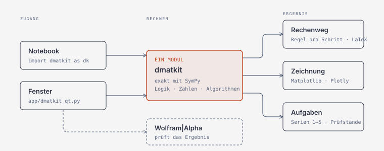

# dmatkit

Diskrete Mathematik mit nachvollziehbarem Rechenweg, gebaut zum Modul
DMATH-ALGO der HSLU (Diskrete Mathematik für Datenstrukturen und Algorithmen).
Deckt die Semesterwochen 1 bis 5 ab: Elementare Datentypen, Aussagenlogik,
Prädikatenlogik, Beweiskalkül und Analyse von Algorithmen. Schwesterprojekt von
[lialkit](https://github.com/EnnioArnold/lialkit) (Lineare Algebra) und
[anakit](https://github.com/EnnioArnold/Analysiskit) (Analysis).

Die Modulendprüfung läuft 90 Minuten auf Papier. Darum zeigt dmatkit jeden
Schritt so, wie er auf dem Blatt stünde, und nennt die Regel dazu. Aufgaben mit
Programmieranteil gibt es als Gerüst mit Prüfstand statt als Musterlösung.

## Installieren

Nötig ist nur Python mit SymPy. Für Zeichnungen und Fenster kommt dazu:

```bash
pip install -r requirements.txt      # sympy, numpy, matplotlib, plotly, PySide6
pip install manimgx                  # Animationen, freiwillig (Python 3.13+)
```

manimgx rendert auf der GPU und schreibt das MP4 ohne ffmpeg. Als Rückfall
geht Manim CE (`brew install cairo pango pkg-config ffmpeg`, `pip install manim`).
Die Videos kommen im Swiss-Design: Schwarz/Weiss mit rotem Akzent. Beispiel:
`python3 -m dmatkit.grafik.anim 409` rendert die Umwandlung 409 → Binär.

Der Ordner `dmatkit/` liegt neben deinen Wochen-Ordnern. Aus einem Notebook in
`Week 3/` heraus:

```python
import sys
sys.path.insert(0, '..')
import dmatkit as dk

dk.eval_bool("False or True and False and True or False")    # SW1: Vorrang, Schritt für Schritt
dk.to_binary(409)                                            # SW1: 110011001
dk.truth_table("(A or B) and not C")                         # SW2: Wahrheitstabelle
dk.check_equivalence("A -> B", "not B -> not A")             # SW2: Kontraposition
dk.has_duplicate([3, 1, 4, 1, 5])                            # SW3: ∃i ∃j, mit Zeuge
dk.entails(["A -> B", "A"], "B")                             # SW4: drei Prüfmethoden
dk.resolution(["A -> B", "B -> C"], "A -> C")                # SW4: Resolution mit Graph
dk.count_steps("decToBin", x=25)                             # SW5: Rechenschritte zählen
dk.max_input_size("n**2", time_limit_s=60)                   # SW5: grösstes n in einer Minute
```

Formeln schreibst du wie im Unterricht: `and or not xor -> <->` oder mit
Symbolen `∧ ∨ ¬ ⊕ → ↔`. Vorrang: not vor and vor xor vor or vor `->` (rechts
geklammert) vor `<->`. Jedes Ergebnis zeigt sich im Notebook von selbst;
`.latex()` liefert den Rechenweg für eine Abgabe, `dk.info()` listet alle
Funktionen auf.

## Aufbau



```
app/        das Fenster (dmatkit_qt.py)
rechnen/    Rechenkern: core (Formelbaum, Parser), render (Rechenweg, Tabellen)
            und je Semesterwoche ein Modul:
              datentypen     SW1  Booleans, Ganzzahlen, Binär, IEEE 754, Mengen
              aussagenlogik  SW2  Wahrheitstabellen, Gesetze, Normalformen, Syntaxbaum
              praedikate     SW3  Prädikate, ∀ und ∃, Negation, Listen-Aufgaben
              kalkuel        SW4  Folgerung ⊨, Ableitung ⊢, KNF, Resolution
              algorithmen    SW5  Rechenschritte zählen, Worst Case, Landau
grafik/     Zeichnungen (plots)
aufgaben/   Übungsaufgaben der Serien 1–5 (exercises), Prüfstände zum Selbstprogrammieren (uebung)
docs/       Architektur-Diagramm
tests/      ein Testskript je Modul
```

## Sicherheit und Genauigkeit

Eingaben werden nie mit `eval` ausgeführt: Formeln liest ein eigener Parser,
arithmetische Terme und Python-Ausdrücke laufen über eine Positivliste auf dem
AST, der Schrittzähler für Algorithmen ist ein eigener Interpreter mit
Schritt- und Tiefenlimit. Gerechnet wird exakt (ganze Zahlen, SymPy-Brüche).

Rechnet dmatkit anders als eine Folie, steht das im Rechenweg oder im Docstring.
Aufgefallen sind zum Beispiel: in der Mitschrift zu 409 steht »204 = 102 · 1 + 0«
(richtig: · 2), `decToBin(0)` liefert in den Folien die leere Zeichenkette, und
die Lerngerüst-Aufgabe `0.0(110)` ergibt 3/7 statt 3/14.

## Die Übungsaufgaben

```python
from dmatkit.exercises import liste, aufgabe, loesen, pruefen, alle_pruefen

liste(3)              # welche es in SW3 gibt
aufgabe("SW3.2")      # die Angabe
loesen("SW3.2")       # durchgerechnet, mit Rechenweg
alle_pruefen()        # alle Aufgaben gegen die erwarteten Werte
```

**Zum Selbstprogrammieren** gibt es Prüfstände ohne Musterlösung:

```python
from dmatkit.uebung import vorlage, pruefe_dec_to_bin

print(vorlage("dec_to_bin"))        # Gerüst zum Abschreiben

def meine_dec_to_bin(n):
    ...

pruefe_dec_to_bin(meine_dec_to_bin)
```

## Das Fenster

```bash
cd dmatkit                       # Ordnername ist egal
pip install -r requirements.txt  # einmalig
python3 app/dmatkit_qt.py
```

Fünf Seiten, eine je Semesterwoche. Jedes Ergebnis zeigt **Rechenweg** und
**Zeichnung**. Die Prüfung über Wolfram|Alpha ist optional und braucht eine
kostenlose AppID von <https://developer.wolframalpha.com/> (Umgebungsvariable
`WOLFRAM_APPID` oder einmalige Eingabe in der App).

Die Zeichnungen (`plot_*`) sind matplotlib-Figuren, `dark=True` schaltet den
Dunkelmodus ein, `plotly_growth` öffnet Wachstumskurven interaktiv.

## Tests

```bash
python3 tests/tests_datentypen.py     # ebenso aussagenlogik, praedikate, kalkuel,
python3 tests/tests_algorithmen.py    # algorithmen, plots, exercises, uebung, app
```

## Noch nicht enthalten

SW6 bis SW12 (Rekursion, Induktion, Kombinatorik, Relationen, Graphentheorie)
sind noch nicht behandelt. Der Aufbau ist darauf ausgelegt: ein neues Modul in
`rechnen/`, seine Namen in `__init__.py`, ein Testskript.
